  

# 🎨 Awesome Computer Animation & Line Art Rendering

### 🌟 Curated Top Animation Suites, Vector Rigging, NPR Shaders & Algorithmic Linework

  
  
  
  
  
  

  <strong>An authoritative catalog of open-source frameworks, 2D/3D non-photorealistic rendering (NPR) shaders, traditional frame-by-frame suites, vector puppetry rigs, and programmatic motion engines.</strong>

  <em>Last updated: November 2026</em>

---

## 📌 Table of Contents
- [🔍 Sector Overview & Market Dynamics](#-sector-overview--market-dynamics)
- [💼 SaaS/Hosted & Commercial Platforms](#-saashosted--commercial-platforms)
- [🚀 Open-Source GitHub Projects](#-open-source-github-projects)
- [📈 Star History](#-star-history)
- [🤝 How to Contribute](#-how-to-contribute)
- [💖 Support & Share](#-support--share)
- [⚖️ Disclaimer](#️-disclaimer)

---

## 🔍 Sector Overview & Market Dynamics

The global 2D computer animation, Non-Photorealistic Rendering (NPR), and vector motion design software sector is estimated at **$1.8 billion – $2.6 billion**, expanding at a steady CAGR of ~6.8% driven by digital streaming pipelines, mobile gaming, anime production, and dynamic UI/UX vector runtimes. 

The market displays a **bifurcated hybrid ecosystem: highly concentrated at the enterprise broadcast and feature studio tier** (anchored by established industry-standard pipelines like Adobe Animate and Toon Boom Harmony), but **broadly fragmented across the indie, creator, and motion programming tiers** where cost-effective freemium applications, perpetual-license desktop tools, and community-driven open-source software (such as Blender Grease Pencil, OpenToonz, and Manim) command massive adoption.

---

## 💼 SaaS/Hosted & Commercial Platforms

| 🏢 Platform | 📊 Company Size (Valuation / Revenue) | 💳 Starting Pricing Tier | 🎁 Free Tier / Trial Limit | 🛠️ Key Features |
| :--- | :--- | :--- | :--- | :--- |
| **[Adobe Animate & Creative Cloud](https://adobe.com)** | **~$150B Market Cap** ($23.8B Annual Revenue) | **$22.99 / month** (standalone annual plan) | **7-day free trial** (Full unrestricted access to all features; converts to paid after 7 days) | Cloud-connected vector 2D animation, audio-synced timeline, HTML5 Canvas/WebGL export, and Character Animator webcam puppetry. |
| **[Clip Studio Paint EX (Celsys)](https://clipstudio.net)** | **~$325M Market Cap** (~$60.5M Annual Revenue) | **$0.99 / month** (Smartphone plan) or **$4.49 / month** (Dual-device PRO plan) / **$237.00** (one-time EX perpetual) | **30-day free trial** (Full feature access; exports/saves disabled upon expiration unless registered; 30 hrs/month free on mobile) | Vector line-art cleanup, unlimited frame-by-frame animation timelines, light tables, onion-skinning, and 3D pose rigging integration. |
| **[Toon Boom Harmony](https://toonboom.com)** | **~$112.5M Valuation** ($147.5M CAD Acquisition by TPG/IMC) | **$31 / month** (Essentials tier, monthly billing) | **14-day free trial** (Full unrestricted studio feature set across Essentials, Advanced, or Premium) | Industry-standard broadcast 2D animation engine featuring master controllers, deep node compositing, deformation rigging, and Z-depth camera. |
| **[Rive](https://rive.app)** | **~$22.5M Total Funding** (~$5M – $7.5M ARR) | **$9 / seat / month** (Cadet tier, annual billing) | **Free Forever Plan** (Full editor access, state machines, and runtimes; exports retain a Rive splash screen; up to 3 collaborative files) | Interactive vector line-art and state machine editor with blazingly fast runtimes for real-time apps, web, games, and UI micro-interactions. |
| **[GarageFarm](https://garagefarm.net)** | **~$10M Est. Valuation** (~$3M – $5M ARR) | **$0.024 / GHz-hour** (CPU Low Priority) / **$0.004 / OB-hour** (GPU Low Priority) | **$25 free trial credits** (Valid for 30 days to benchmark and render test sequences; includes 33% Blender discount) | Distributed cloud render farm infrastructure providing automated job queuing for Blender Grease Pencil, Freestyle line art, and 2D/3D sequences. |
| **[Moho Pro (Lost Marble)](https://lostmarble.com)** | **~$3M – $5M Est. Valuation** ($750K IP acquisition buyout) | **$59.99** (Moho Debut perpetual) / **$399.99** (Moho Pro perpetual) | **30-day free trial** (Full access to Smart Bones rigging, physics engine, and vector tools on Windows and macOS) | Vector-based 2D character rigging powerhouse renowned for Smart Bones, bezier mesh warping, automated tweening, and physics simulation. |
| **[CelAction2D](https://celaction.com)** | **~$2M – $4M Est. Valuation** (~$1M ARR) | **$100 / month** (Studio Edition month-to-month) / **$825 / year** | **Evaluation kit upon request** (No public download; trial kit provided directly to vetted production studios and animators) | High-throughput vector and bitmap 2D puppet rigging software optimized for long-running television broadcast pipelines (e.g., *Peppa Pig*). |
| **[TVPaint Animation](https://tvpaint.com)** | **~$2M – $4M Est. Valuation** (~$1M ARR) | **€500 (~$540)** (TVPaint Standard perpetual) / **€1,250 (~$1,350)** (TVPaint Pro perpetual) | **Unlimited-duration free trial** (All tools and brush engines functional; project saving and file exports are permanently disabled) | Bitmap-based traditional 2D animation suite prized by feature animators for paper/pencil brush physics, virtual light tables, and CTG colorization. |
| **[DigiCel FlipBook](https://digicel.net)** | **<$1M Est. Valuation** (<$500K ARR) | **$19.99** (FlipBook Lite perpetual) / **$99.99** (FlipBook ProHD perpetual) | **Unlimited-duration free trial** (All tools and features available with no expiration date; exported frames/videos include a watermark) | Classic digital light-table software faithfully emulating traditional pencil-test animation, X-Sheets (exposure sheets), and multi-layer ink-and-paint. |

---

## 🚀 Open-Source GitHub Projects

*Curated collection sorted in descending order by repository GitHub Stargazers count.*

- **[FFmpeg](https://github.com/FFmpeg/FFmpeg)**   
  🎬 Universal command-line multimedia framework used across animation pipelines for assembling lossless frame sequences, generating ProRes/WebM transparency passes, and palette-quantized GIF encoding.

- **[Manim Community](https://github.com/ManimCommunity/manim)**   
  📐 Programmatic Python animation engine built for rendering mathematically precise vector line art, geometrical transformations, and animated technical explainers.

- **[Aseprite](https://github.com/aseprite/aseprite)**   
  👾 Open-source pixel-art and animated sprite tool featuring frame-by-frame onion skinning, color palettes, stroke outlines, and timeline sprite sheet generation.

- **[Blender Grease Pencil](https://github.com/blender/blender)**   
  🖌️ Full-featured open-source 3D/2D hybrid animation suite enabling artists to draw vector strokes directly in 3D viewport space, calculate geometric line-art outlines, and render stylized NPR/cel-shaded animations.

- **[Rough.js](https://github.com/rough-stuff/rough)**   
  ✏️ Lightweight graphics library that allows drawing in a sketchy, hand-drawn-like style using Canvas and SVG elements, perfect for generative organic line-art rendering.

- **[Motion Canvas](https://github.com/motion-canvas/motion-canvas)**   
  ✨ TypeScript-first programmatic animation tool tailored for creating clean vector motion graphics, animated line drawings, and interactive visual explanations.

- **[Krita](https://github.com/KDE/krita)**   
  🎨 Professional open-source creative painting and 2D animation studio equipped with raster/vector brush stabilizers, onion skinning, audio track playback, and storyboard management.

- **[LibreSprite](https://github.com/LibreSprite/LibreSprite)**   
  🕹️ Free and open-source fork of Aseprite designed for animated sprites, pixel line art, frame looping, and retro digital 2D animation.

- **[OpenToonz](https://github.com/opentoonz/opentoonz)**   
  🏮 Production-proven 2D animation suite customized by Studio Ghibli, featuring GTS optical paper scanning, vector/raster ink-and-paint, plastic mesh rigging, and nodal special effects.

- **[GIMP](https://github.com/GNOME/gimp)**   
  🖼️ Extensible open-source image manipulation program supporting brush strokes, path-based line drawing, line art extraction, and GAP (GIMP Animation Package) frame sequencing.

- **[Perfect Freehand](https://github.com/steveruizok/perfect-freehand)**   
  ✒️ Minimal JavaScript library that draws smooth, organic variable-width line-art strokes based on pointer speed and pressure data.

- **[MyPaint](https://github.com/mypaint/mypaint)**   
  📝 Distraction-free digital drawing and line-art program featuring infinite canvas support and a responsive brush engine designed for sketching and preliminary animation linework.

- **[Synfig Studio](https://github.com/synfig/synfig)**   
  🦴 Industrial-strength 2D vector animation system that eliminates manual in-between frame drawing using mathematical path morphing, bones, and cutout distortion layers.

- **[Friction](https://github.com/friction2d/friction)**   
  🎞️ Modern open-source 2D vector animation desktop software (successor to Enve) offering curve graph interpolation, expression scripting, sound integration, and raster brush FX.

- **[Pencil2D](https://github.com/pencil2d/pencil)**   
  ✏️ Easy-to-use traditional hand-drawn 2D animation tool featuring seamless switching between raster and vector layers, onion-skin lightboxing, and keyframe management.

- **[jdhruv14/line-art-animation](https://github.com/jdhruv14/line-art-animation)**   
  🤖 Specialized open-source computer animation algorithm and line-art rendering project dedicated to automated line stroke extraction, motion smoothing, and expressive rendering pipelines.

- **[Malt NPR Pipeline](https://github.com/bnpr/Malt)**   
  🔮 Non-Photorealistic Rendering (NPR) render engine for Blender supporting custom GLSL shaders, line art extractors, halftone screens, and Japanese anime cel-shading.

- **[Wick Editor](https://github.com/Wicklets/wick-editor)**   
  🌐 Accessible, web-based 2D frame-by-frame animation and game creation platform with vector drawing tools and timeline JavaScript coding capabilities.

- **[Tahoma2D](https://github.com/tahoma2d/tahoma2d)**   
  📽️ Artist-focused fork of OpenToonz bringing an updated ergonomic user interface, integrated FFmpeg export, stop-motion webcam capture, and refined line vectorization.

- **[TupiTube Desk](https://github.com/utopianlabco/tupitube.desk)**   
  🎒 Educational 2D animation suite geared towards kids, students, and hobbyists with vector linework, stop-motion capture, and basic frame-by-frame tools.

---

## 📈 Star History

---

## 🤝 How to Contribute

Contributions are welcome! Help grow this repository by submitting high-quality open-source and commercial additions:

1. 🍴 **Fork the repo**.
2. 🌿 **Create a new branch** (`git checkout -b feature/new-animation-tool`).
3. 📝 **Add/edit entries in `README.md`** (follow existing tabular and markdown badge conventions).
4. 💡 **Include**: tool name, official link, 1–2 sentence factual summary, pricing tier, and free trial limit.
5. 🚀 **Submit a Pull Request** with a concise description of your additions.

---

## 💖 Support & Share

Thank you for exploring and utilizing this curated guide! If this list has helped your creative pipeline, production setup, or graphics programming journey, please consider supporting the project:

- ⭐ **Star this repository** to improve discoverability across GitHub.
- 🍴 **Fork & Share** with colleagues, animation communities, Discord groups, and Reddit.
- ☕ **Buy me a coffee / Sponsor**: Support ongoing maintenance and curation on the [GitHub Sponsors Dashboard](https://github.com/sponsors/ishandutta2007). Your sponsorship helps keep these community resources up-to-date and accessible to all creators!

---

## ⚖️ Disclaimer

- This is an independent, **community-curated** reference catalog — not an official endorsement of any commercial platform or open-source library.
- High-resolution 2D/3D line-art rendering (such as Blender Grease Pencil with complex occlusion modifiers or 4K OpenToonz node trees) benefits significantly from multi-core CPUs, modern Vulkan/OpenGL GPUs, and fast NVMe scratch storage.
- Always archive raw vector and layered project files (`.blend`, `.tnz`, `.kra`, `.sifz`) alongside lossless PNG image sequences before final video compression.

---

  <strong>Crafted with ❤️ for 2D/3D animators, technical directors, indie artists, and graphics programmers.</strong> 
  <em>Let's make computer animation and line art rendering more open, expressive, and artist-owned.</em>

